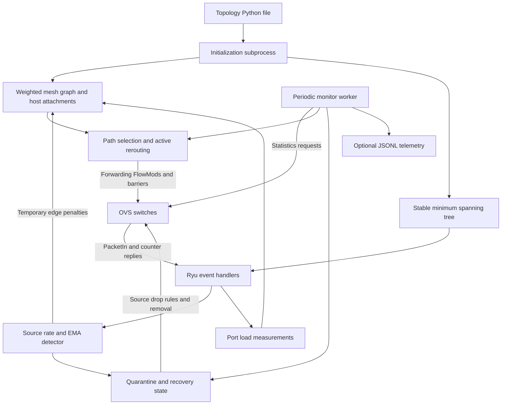
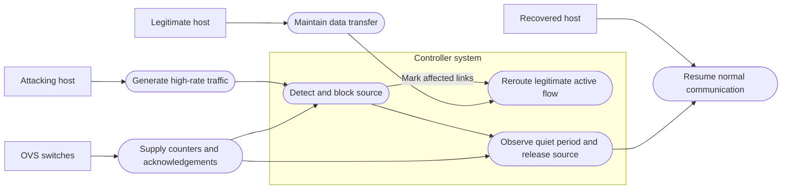
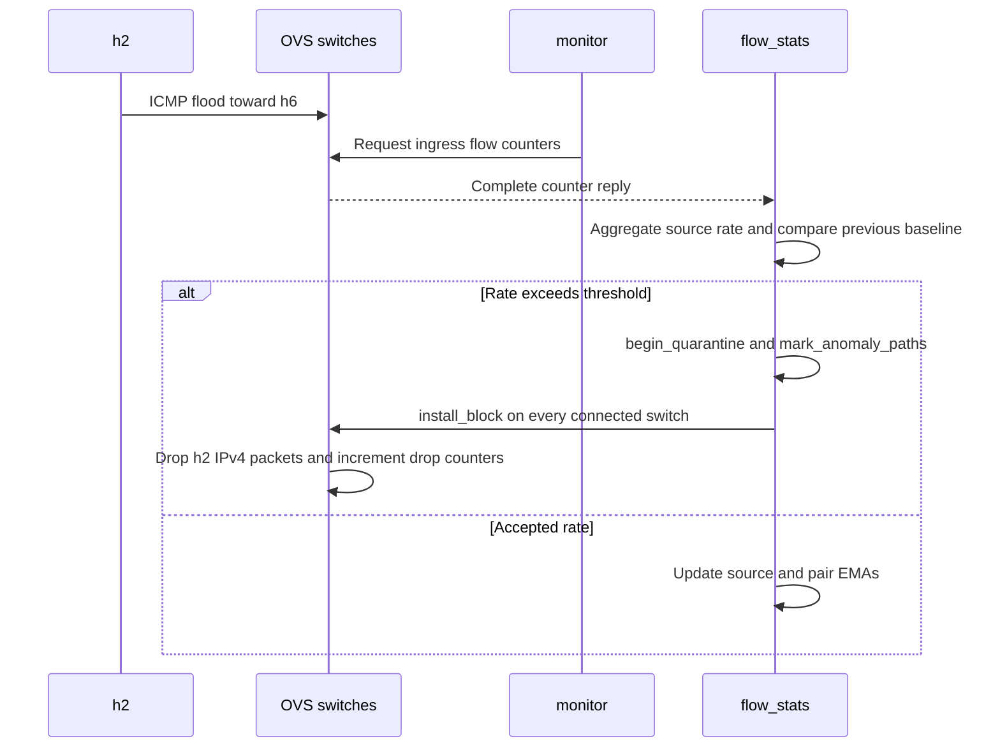
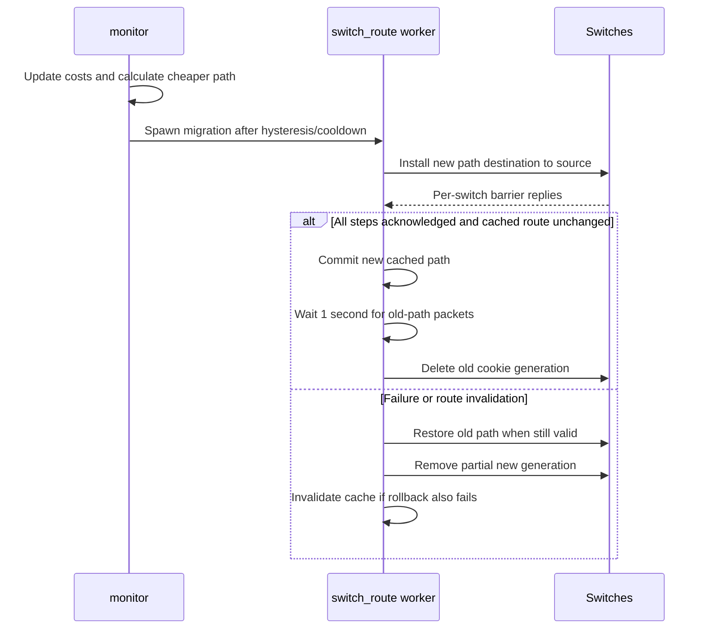
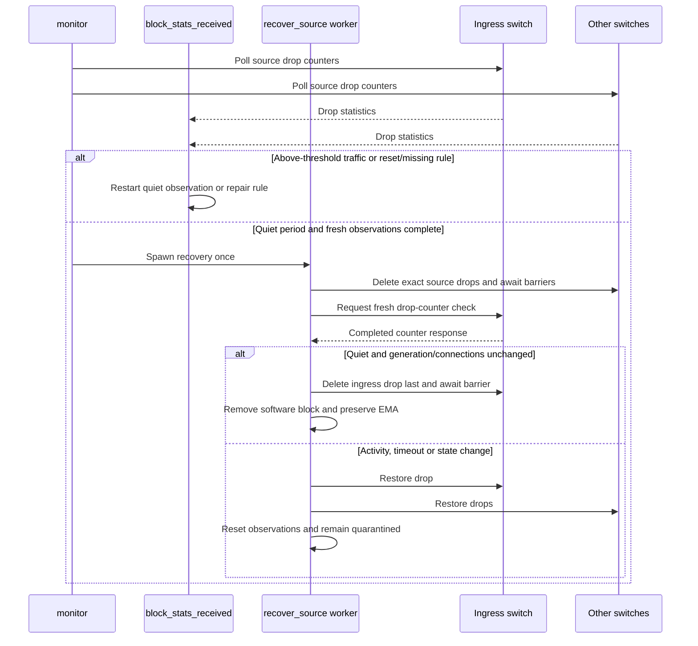

# Mesh controller architecture and function reference

Source: `mesh_controller.py`, inspected 13 November 2026. This document describes the current implementation, including 2-second polling. It does not change controller behavior.

## 1. Purpose and scope

`MeshController` is a Ryu application using OpenFlow 1.3. It provides loop-safe forwarding in the supplied Mininet mesh, monitors source traffic, blocks anomalous IPv4 sources, changes active legitimate routes in response to dynamic link costs, and automatically releases quarantined sources after observed anomalous traffic stops.

A “flow” here is a directed **IPv4 source/destination pair**, not a TCP/UDP five-tuple. All protocols and transport ports for that pair share a route. Detection aggregates monitored pair rates by source host. The reverse direction is a separate route.

The controller reads `reference/ceg_mesh_topo.py` at startup. This is a configured topology snapshot, not live LLDP discovery. Switch connection events are tracked, but arbitrary physical link failures and topology changes are not dynamically discovered and removed from the graph.

## 2. Architecture



### Two-table forwarding pipeline

| Table | Priority | Match/purpose | Result |
|---|---:|---|---|
| 0 | 100 | IPv4 source in quarantine | Drop; count blocked packets |
| 0 | 30 | Configured host's ICMP echo replies | Go to table 1 without anomaly accounting |
| 0 | 20 | Configured ingress port and source/destination IPv4 pair | Count source traffic; go to table 1 |
| 0 | 0 | Default | Go to table 1 |
| 1 | 20 | Input port and IPv4 source/destination pair | Output along the committed route |
| 1 | 10 | Ethernet type and learned destination MAC | Forward non-IPv4 traffic along the stable tree |
| 1 | 0 | Table miss | Send complete packet to controller |

The priority-100 firewall overrides both accounting and the echo-reply exception. It matches the **source**, not the destination. Traffic toward a blocked host is not automatically destination-filtered, but replies from that host are dropped, so bidirectional applications such as ping fail. ARP is not matched by these IPv4 source-drop rules.

ARP/unknown L2 flooding uses only a minimum spanning tree calculated from original delays. IPv4 unicast may use all mesh links. Keeping these paths separate prevents broadcast loops without disabling redundant unicast links.

### State and ownership

| State | Meaning |
|---|---|
| `graph`, `tree` | Dynamic unicast graph and fixed broadcast/L2 tree |
| `ports`, `port_peers` | Switch-neighbor output ports and reverse port-to-neighbor lookup |
| `host_ports`, `ingress_hosts`, `host_attachments` | Trusted configured host attachment information |
| `host_locations` | MAC locations learned only on host-facing ports |
| `datapaths` | Current Ryu switch connection objects |
| `flow_samples`, `source_baselines` | Per-pair counter snapshots/EMAs and aggregate source EMA |
| `source_warmups` | Active calibration time, last observation, completion status |
| `port_samples` | TX byte snapshots, switch duration and measured directional rate |
| `routes` | Directed IP-pair path, per-switch port map, cookie, activity and reroute timestamps |
| `blocked_sources`, `source_quarantines` | Software source guard and recovery generations/counter observations |
| `block_requests`, `stats_parts` | Outstanding drop-stat requests and multipart reply assembly |
| `barrier_waiters`, `switch_errors` | Acknowledgement events and per-switch error counts |
| `route_pins`, `telemetry_path` | Optional experiment-only path constraints and telemetry output |

Ryu event handlers process replies. Cooperative workers perform periodic monitoring, rerouting and recovery. Waiting for barriers happens in workers so event handlers can deliver the replies. A barrier acknowledges prior OpenFlow processing; it does not guarantee loss-free packet delivery or a network-wide atomic update.

## 3. Algorithms and current settings

### Detection and protected warmup

Rates are packet-counter differences divided by switch flow-duration differences. Positive monitored pair rates are aggregated for each source. Zero-traffic observations do not decay its baseline.

```text
Warmup threshold = 1500 packets/s
Normal threshold = max(1500, 5 × previous accepted source EMA)
Accepted EMA = 0.2 × current rate + 0.8 × previous EMA
```

The first accepted sample initializes the EMA directly. The current sample is tested before learning; samples above threshold trigger quarantine and are excluded from EMA updates. ICMP echo replies bypass anomaly accounting so a flood victim is not classified merely for responding.

Each new source learns during 10 seconds of active observations, under a fixed 1500 pps ceiling. Gaps exceeding three polling periods do not add calibration time. The sample completing warmup still uses the fixed cap; the next uses normal EMA detection. This is not an unrestricted grace period or proof that accepted traffic is benign. Quarantine ends unfinished warmup, and recovery retains the accepted baseline.

### Dynamic link cost and path selection

```text
Directional rate = 8 × TX byte delta / port-duration delta
U = min(1, max(rate_ab, rate_ba) / configured capacity)
C = original delay in ms + 4 × U + 20 × anomaly_indicator
```

An undirected edge uses the busier TX direction; summing TX and RX would count packets twice. Original cost is stored separately, so repeated recalculation does not compound penalties. Port-statistics gaps retain the previous load estimate.

Detected sources penalize links inferred from their positive ingress-pair samples and committed paths. Penalties last 30 seconds after marking and are binary, not additive per attacker. Continued blocked traffic resets source recovery through drop counters but does not itself repeatedly call link attribution.

Dijkstra finds the minimum total live cost. Existing routes change only if the improvement is at least `max(2, 10% of current path cost)` and the route has not changed in the last 5 seconds. Pinned experiment routes and routes involving blocked endpoints are skipped. This limits oscillation but cannot guarantee no flapping under every workload.

### Recovery and independent timers

A blocked source becomes eligible after 30 seconds without an observed above-threshold drop rate. Normal low-rate probes do not reset this interval. Fresh samples, at most 3 seconds old, are required from every configured switch and its current connection. Missing data is not evidence of silence.

| Setting | Current value | Effect |
|---|---:|---|
| `POLL_SECONDS` | 2 s | Monitor sleep between cycles; not a guaranteed detection deadline |
| `SOURCE_RECOVERY_QUIET_SECONDS` | 30 s | Required observed quiet period |
| `RECOVERY_STATS_MAX_AGE` | 3 s | Drop-request expiry, freshness and final-check wait limit |
| `ANOMALY_HOLD_SECONDS` | 30 s | Independent link-penalty lifetime |
| `ROUTE_IDLE_SECONDS` | 10 s | Controller removes inactive cached routes |
| `BARRIER_TIMEOUT_SECONDS` | 2 s | Maximum wait for an acknowledgement |
| `OLD_PATH_DRAIN_SECONDS` | 1 s | Retain old-only rules after successful migration |

At 2-second polling, a 3-second freshness allowance has limited scheduling margin. Delayed replies may defer recovery. Actual blocking/release times also include polling phase, reply delivery and worker scheduling. Link penalties can expire before source release.

## 4. Use cases and interaction diagrams

The following Mermaid diagrams render in Markdown viewers with Mermaid support. The first is a use-case-style actor/system view; the following sequence diagrams show implementation ordering and failure handling.



### Attack: h2 floods h6

Precondition: switches are connected, forwarding paths and source accounting are installed. Outcome: h2's source IP is blocked on all connected switches; legitimate links remain available.



### Rerouting: preserve h1 to h6 during h2's anomaly

Precondition: h1-h6 is active on `[1,2,6]`. With s2-s6 penalized, its cost is approximately 39 versus 22 through `[1,2,3,6]`, ignoring small load terms. Outcome: migrate if hysteresis/cooldown checks pass, and reconsider the original route after penalty expiry.



### Source recovery: h2 stops flooding

Precondition: h2 is quarantined; its ingress drop rule still counts attempts. Outcome: release only after verified quiet time and acknowledged removal, without a controller restart.



## 5. Every function in MeshController

Unless stated otherwise, methods act through state changes, messages or logging and return no meaningful value. Event methods receive a Ryu event (`ev`); `datapath` represents one live switch connection.

### Initialization and switch pipeline

#### `__init__(self, *args, **kwargs)`

Initializes the Ryu app and executes a separate Python interpreter to import the Mininet topology and return JSON. This avoids importing Mininet into Ryu's eventlet-patched environment. It builds the graph, port maps, host attachments, state dictionaries and base-cost spanning tree. Mesh delays must be positive millisecond strings and bandwidth must be positive. Invalid topology or invalid route pins fail initialization. Pins must be simple connected paths between the configured endpoint switches. Finally it starts `monitor` with `hub.spawn`.

#### `switch_features(self, ev)`

Handles the OpenFlow features handshake in CONFIG state. Deletes existing rules from all tables, installs table 1's controller table-miss rule and table 0's default goto. Adds host-ingress accounting and ICMP echo-reply exceptions, then reinstalls currently blocked source rules. Clearing stale rules prevents leftovers from a previous connection from overriding this controller. A controller restart loses in-memory quarantine state; a switch reconnect during the same run does not.

#### `add_flow(self, datapath, priority, match, actions, table_id=1, cookie=0)`

Builds an APPLY_ACTIONS instruction and sends an OFPFlowMod to the selected table. Callers supply match, priority and cookie; defaults target table 1. Empty actions implement a drop. No idle/hard timeout is set, so lifecycle is managed by explicit controller deletions. This helper does not wait for acknowledgement.

#### `goto_forwarding(self, datapath, priority, match, cookie=0)`

Installs a table 0 rule with GotoTable(1). OVS counters record matches while forwarding continues. Used for default progression, ingress accounting and the echo-reply exception. It does not itself calculate rates or output a packet.

#### `packet_in(self, ev)`

Decodes Ethernet and IPv4 headers. Drops queued packets from blocked sources before they can escape via PacketOut, rejects unsupported switches/frames, and ignores LLDP/IPv6. Learns source MAC locations only on configured host ports. IPv4 packets use `route_ipv4`; an accepted output port produces a PacketOut. Known non-IPv4 destinations use the stable tree and receive a type-specific L2 forwarding rule. Unknown destinations flood only to host/tree ports excluding ingress; copies arriving on non-tree transit ports are discarded. ARP rules include Ethernet type so they cannot bypass IPv4 routing.

#### `state_change(self, ev)`

Handles MAIN/DEAD connection events. Registers the current datapath or removes it only if the dead object is still current. Clears that switch's flow samples, partial replies and port samples; invalidates cached routes crossing it. Removes its quarantine samples and restarts quiet observation for quarantined sources. It does not remove the switch or failed links from the configured graph.

### Monitoring and source classification

#### `monitor(self)`

Infinite cooperative loop. Expires old drop-stat requests and wakes their waiters without declaring successful completion. Checks recovery eligibility, removes idle non-migrating routes, updates every link cost (including penalty expiry), reevaluates routes and writes telemetry. Requests source accounting, all-port counters and route-cookie forwarding counters from connected switches; requests drop counters while quarantines exist and no request is outstanding for that switch. Sleeps for `POLL_SECONDS`. Decisions use the most recently received samples; requests issued at the end supply subsequent updates.

#### `flow_stats(self, ev)`

Rejects obsolete connection objects and assembles multipart replies keyed by switch ID and transaction ID. Recognized drop-stat requests are dispatched to `block_stats_received`. Route-cookie counters update activity only for the current generation at its ingress switch. Monitor-cookie rows yield per-pair packet rates using switch durations; initial/reset-duration samples use count divided by duration. Nonpositive intervals/deltas and blocked sources are excluded. Positive rates aggregate by source. Calls `source_threshold`; exceeding it starts quarantine, attributes link penalties and installs drops on all current switches. Otherwise updates source and pair EMAs and logs the baseline. This handler is the main connection between detection, firewall and routing cost.

#### `source_threshold(self, source, rate, now)`

Returns a numeric pps threshold and advances per-source warmup state. Completed sources use `max(1500, 5 × accepted EMA)`, with a provisional EMA of 1 if absent. Incomplete sources retain the fixed cap. Accepted positive observations separated by at most three polling periods add elapsed active time; larger gaps do not. Reaching 10 seconds marks completion and logs it, but that call still returns the warmup cap. It does not itself update the EMA or install a firewall rule.

### Route construction and lifecycle

#### `route_ipv4(self, datapath, ingress, source, destination)`

Returns an output port or `None`. For an uncached pair, requires entry at the source's configured host attachment and a known destination. Selects the evaluation pin or live-cost shortest path, rejects paths containing disconnected switches, builds/caches the route and installs it without waiting for barriers. For both new and existing routes, validates that this switch and input port belong to the committed path. Refreshes activity before returning the output. Transit PacketIns cannot independently create a different path.

#### `remove_route(self, key)`

Pops the directed pair from the route cache and calls `delete_route_rules`. Callers must supply an existing key. Used for idle expiry, connection invalidation and rollback failure. It preserves firewall and accounting state.

#### `delete_route_rules(self, route)`

Sends table-1 delete commands on connected switches along the supplied path, using the exact route cookie and full cookie mask. Deletes only that route generation, including retired fragments; does not delete source drops or another generation. Disconnected switches are skipped and no barrier is awaited here.

#### `make_route(self, key, path)`

Returns a new route dictionary. Increments the route sequence and combines it with `ROUTE_COOKIE_PREFIX` to allocate a generation. Copies the path, initializes activity/reroute timestamps and counters, and constructs each switch's expected input/output ports. Endpoint ports come from host attachments; intermediate ports come from the neighbor map. Does not install rules or update the route cache by itself.

#### `install_path(self, key, route, wait=False)`

Walks the route from destination back to source and installs priority-20 table-1 matches for input port, IPv4 type and IP pair. Optional waiting acknowledges each switch before proceeding upstream and checks for new OpenFlow errors. Initial routing uses `wait=False`; migration/rollback uses `True`. Missing connections or failed acknowledgements raise to the caller. Input-port-specific rules allow old-only and new-only path portions to coexist during migration.

#### `wait_for_barrier(self, datapath)`

Assigns a transaction ID to a barrier request, registers a cooperative event and sends it. Waits up to 2 seconds; timeout raises RuntimeError. Always removes its waiter in a finally block. The caller decides whether to roll back or defer an operation.

#### `barrier_reply(self, ev)`

Looks up the switch/transaction waiter and sets it when found. Unknown or already-expired replies have no effect. This event handler unblocks workers performing acknowledged updates.

#### `openflow_error(self, ev)`

Handles OpenFlow errors in CONFIG or MAIN state. Increments a per-switch error counter and logs type/code. Installation/deletion workers compare counter values around acknowledged operations to detect failure. It does not directly retry or roll back, and its counter is per switch rather than per individual FlowMod.

#### `reevaluate_routes(self, now)`

Examines cached routes. Skips in-progress updates, pins, blocked endpoints and routes still in cooldown. Computes a shortest path with current weights and compares complete old/new path costs. If the path differs and meets both absolute/relative improvement requirements, sets the switching guard and spawns `switch_route`. It does not move packets itself.

#### `switch_route(self, key, old, path, old_cost, new_cost)`

Creates and installs a new generation with barriers. Checks that the cached route is still the same old object, then commits the new cache and logs REROUTE. Keeps old-only rules for one second before deleting the old cookie. On failure, attempts acknowledged restoration of the old route if still current, resets its counter/activity timing, and removes new-generation fragments. If rollback fails, logs and invalidates the cached route. Always clears the old object's switching flag. This reduces transition loss but is not a guarantee of atomic, lossless migration.

### Link measurements and telemetry

#### `write_telemetry(self, now)`

Appends a JSONL record only when `MININET_TELEMETRY_FILE` is set. Records monotonic time, blocked sources, link costs/load/penalty expiry, route paths/cookies/switching flags, quarantine observation time, warmup state and selected configuration. It is called once per monitor cycle, currently approximately every 2 seconds; its older “one-second” docstring is not the actual timing guarantee. It records controller state, not measured receiver loss or throughput; iperf supplies those separately.

#### `port_stats(self, ev)`

Rejects replies from obsolete datapaths. Processes only known mesh ports with supported TX counters. Computes bps from byte and port-duration deltas, treating first samples/resets/nonpositive intervals as a zero-rate reference. Saves each directional sample and calls `update_link_cost` immediately. Missing replies leave prior stored rates in place; there is no port-sample freshness timeout here.

#### `update_link_cost(self, a, b, now)`

Reads both endpoint TX-rate samples, chooses their maximum, caps utilization at 1 and evaluates whether the penalty expiry is still in the future. Recalculates weight from immutable base cost plus load and binary anomaly terms. Updates all edge metrics every call; emits LINK_COST only when weight changes by at least 0.1 or anomaly status changes. Does not directly reroute; `reevaluate_routes` does that separately.

#### `mark_anomaly_paths(self, source, dpid)`

Finds positive-rate source samples at the detecting ingress switch and looks up their cached paths. Collects unique undirected edges, extends each expiry to at least now + 30 seconds, updates their costs and logs ANOMALY_LINKS. Attribution is inferred from installed paths and aggregate counters, not direct identification of attack packets on each link. No cached path means no corresponding attributed edge.

### Quarantine and recovery

#### `begin_quarantine(self, source)`

Ends unfinished warmup, adds the source to the software block set and creates a new quarantine object with detection time, empty samples and `recovering=False`. Retains accepted EMA data. The object identity is the recovery generation token. Does not install switch rules itself; `flow_stats` follows it with rule installation.

#### `request_block_stats(self, datapath)`

Requests table-0 BLOCK_COOKIE counters and returns a request dictionary containing send time, a snapshot of quarantine object references, a waiter event, completion flag and present-source set. Registers by switch/transaction ID before sending. Using drop counters is essential because higher-priority blocking prevents normal monitor rules from seeing continuing attack attempts.

#### `block_stats_received(self, datapath, rows, request)`

Consumes a complete drop-counter response. Ignores sources whose quarantine object has changed. Missing/unsupported rules normally invalidate that switch's sample, reset quiet time and reinstall the block; deliberate removal during recovery is exempt. First observations, changed connections or reset counters restart the observation window. Nonadvancing durations cannot establish freshness. Valid deltas update per-switch rates/timestamps. The maximum stored switch rate is compared with normal EMA detection threshold; above-threshold traffic resets quiet time. Low-rate probes do not. Marks the request complete, records sources actually observed and signals its waiter.

#### `recovery_ready(self, quarantine, now)`

Returns a Boolean. Requires at least 30 seconds since the last anomaly observation and a sample from every graph switch, from its current connection, no older than 3 seconds. A missing/disconnected/stale switch prevents release. This checks observation quality and elapsed time; it does not delete rules.

#### `recover_ready_sources(self, now)`

Scans quarantine objects. When one is ready and no worker is active, sets its recovering guard and spawns `recover_source`. Prevents duplicate release workers across monitor cycles.

#### `delete_source_block(self, datapath, source)`

Sends a strict table-0 delete for the exact priority-100 IPv4-source rule with BLOCK_COOKIE and a full cookie mask. Awaits a barrier and checks whether the switch error counter increased. Raises on failure. Other sources' blocks and accounting/forwarding rules are unaffected.

#### `recover_source(self, source, quarantine)`

Snapshots current connections and finds the source ingress. Rechecks readiness; removes downstream source drops first with acknowledgement. Then requests fresh ingress drop counters and requires a completed response containing the source, sufficient quiet time, unchanged quarantine object and unchanged switch connections. Removes ingress drop last with acknowledgement, clears software quarantine/block state and logs SOURCE_RECOVERED. Accepted baselines/accounting samples remain. On failure, logs deferred recovery, resets quiet time, clears observations and attempts to reinstall/acknowledge drops on all connected switches; restoration errors are logged individually. Finally releases the recovering guard. Continued low-rate traffic can be present at release; the criterion is absence of anomalous-rate traffic, not absolute silence.

#### `install_block(self, datapath, source)`

Uses `add_flow` to install a priority-100 table-0 IPv4-source rule with empty actions and BLOCK_COOKIE. Sends a barrier request and logs FIREWALL, but does not wait through `wait_for_barrier` itself. Zero timeouts keep the block until explicit removal. Called during initial detection, reconnect restoration and recovery failure/repair. No mesh link is disabled, allowing legitimate sources to continue using it or alternative paths.

## 6. Operational interpretation and boundaries

- The current 30-second recovery setting differs from earlier 50-second experiments. Read constants rather than assuming old timings.
- Legitimate high-rate workload must be compatible with the warmup cap and learned baseline. Detection is a rate heuristic, not application-aware attack classification.
- Source IP rules rely on the configured lab addressing; this is not comprehensive anti-spoofing or a production identity system.
- Initial path installation is not barrier-confirmed. Active reroutes are acknowledged and have rollback, but neither method guarantees zero transient loss.
- Source quarantine, link penalties and route cooldowns are separate state machines. A cheaper route can recover before the attacking host is released.
- Pins from `MININET_ROUTE_PINS` deliberately disable dynamic rerouting for those pairs; keep the legitimate measured pair unpinned.
- Logs to correlate include WARMUP_COMPLETE, BASELINE, ANOMALY, ANOMALY_LINKS, FIREWALL, LINK_COST, ROUTE, REROUTE and SOURCE_RECOVERED. Failure logs distinguish acknowledgement problems and deferred recovery.

For the implementation and experimental instructions, see [mesh_controller.py](mesh_controller.py) and [README.md](README.md).
