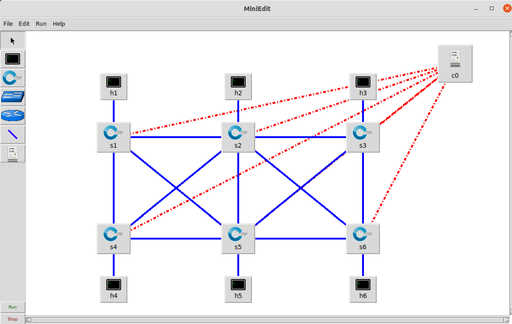
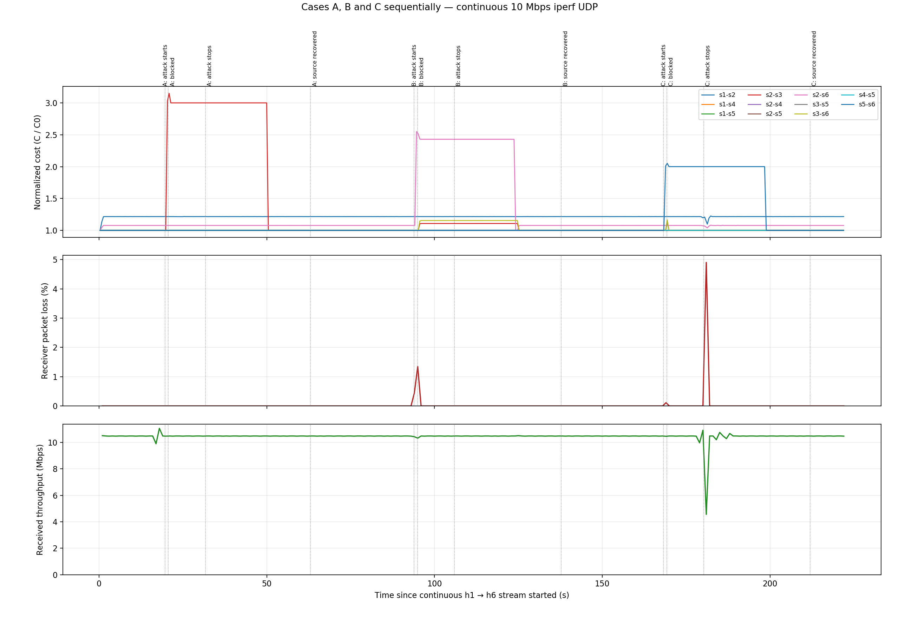

# CA2: Laboratory Assignment (Anomaly aware Routing and Blocking Controller)

This lab uses Ryu and OpenFlow 1.3 to route traffic through a six-switch mesh, prevent broadcast loops, detect unusually high source traffic rates, and block anomalous sources. Legitimate hosts retain access to the mesh links after a source is blocked.


## Environment Setup

Mininet, Open vSwitch, Ryu, and Python 3 must be installed in the VM. The launcher uses `sudo` to create network namespaces and configure switches.

Install the additional graph and test utilities on the existing Ubuntu lab image.

```bash
sudo apt-get update
sudo apt-get install -y python3-networkx hping3 tcpdump python3-matplotlib
sudo systemctl start openvswitch-switch
```

Check the tools and required topology before starting.

```bash
command -v mn ryu-manager ovs-vsctl ovs-ofctl hping3 tcpdump timeout
mn --version
ovs-vsctl --version
python3 -c 'import networkx; from importlib.metadata import version; print("Ryu", version("ryu")); print("NetworkX", networkx.__version__)'
test -r ~/MininetLab/reference/ceg_mesh_topo.py
sudo ovs-vsctl show
```

## Topology in MiniEdit
Open a new terminal inside the VM, run
```bash
sudo -E python ~/mininet/examples/miniedit.py
```
Open `/MininetLab/reference/ceg_mesh_topo.mn` in MiniEdit, click `Run`.



## Traffic Monitoring, Anomaly Detection and Source Blocking
### Detect anomaly using EMA
For each active flow, the sampled rate is the increase in its packet counter divided by the increase in its switch-reported flow duration. Rates are aggregated by source. Accepted samples update per-flow and per-source EMAs.

```text
EMA_new = alpha × current_rate + (1 - alpha) × EMA_previous
threshold = max(MIN_THRESHOLD_PPS, ANOMALY_MULTIPLIER × source_EMA_previous)
anomalous when current_source_rate > threshold
```

The comparison uses the previous baseline. An anomalous sample is excluded from EMA updates. Idle samples leave baselines unchanged.


| Constant | Default | Meaning |
| --- | --- | --- |
| `POLL_SECONDS` | `1.0` | Flow-statistics polling interval |
| `EMA_ALPHA` | `0.2` | Weight assigned to the newest accepted sample |
| `ANOMALY_MULTIPLIER` | `5.0` | Source EMA multiplier |
| `MIN_THRESHOLD_PPS` | `1500.0` | Minimum anomaly threshold in packets/s |


### Testing
In terminal 1, start the controller.

```bash
cd ~/MininetLab
bash run_controller.sh
```

`run_controller.sh` runs `ryu-manager` with `--observe-links` and listens on TCP port `6653`. Startup logs should report six switches, 11 mesh links, six host ports, and the broadcast tree.

In terminal 2, run the topology using Mininet.

```bash
cd ~/MininetLab
bash run_topology.sh
```

`run_topology.sh` starts Mininet with the topology and connects to the remote controller at `127.0.0.1:6653`. At the `mininet>` prompt, inspect the network and check connectivity.

```text
nodes
net
pingall
```

A fresh run should report `0% dropped (30/30 received)`.

Now, establish the source baseline in Mininet.

```text
h1 ping -c 10 h2
```

Watch terminal 1 for `BASELINE source=10.0.0.1` messages. Then run the following command in terminal 2 to simulate attack by flooding.

```text
h1 hping3 --icmp --flood h2
```

Stop the flooding after about 10 seconds. Check terminal 1, the controller should log an `ANOMALY` for `10.0.0.1` followed by six `FIREWALL` messages. Then inspect the actual switch rules by running following command in terminal 2.

```text
sh ovs-ofctl -O OpenFlow13 dump-flows s1 table=0
```

The flow table should contain a priority-100 rule matching `nw_src=10.0.0.1` with `actions=drop`.

Immediately after the flood ends, check that the source remains blocked during its recovery countdown and that the other hosts remain connected.

```text
h1 ping -c 3 h2
h4 ping -c 3 h2
```
h2 should receive no replies from h1 but can receive replies from h4.


### Automatic source recovery

The controller automatically releases a blocked source after **30 seconds without further traffic above its anomaly threshold**. The controller stays running throughout blocking and recovery.

While a source is blocked, the priority-100 drop rules continue counting its IPv4 packets. The controller polls those counters once per second. The ordinary forwarding counters cannot indicate whether the flood stopped because the drop rule prevents packets from reaching them.

The recovery decision uses the same threshold as source detection, `max(1500 packets/s, 5 × the accepted source EMA)`. The busiest switch's source-drop rate represents continuing activity without counting the same in-flight packets several times. A renewed high-rate burst resets the 30-second countdown. Occasional normal ping attempts below the threshold leave the countdown running. Recovery measurements include all IPv4 packets matching the source block.

The accepted EMA baseline and accounting samples are retained, so a recovered source remains subject to normal detection and a later flood can be blocked again. The 30-second link-cost anomaly penalty has its own timer and may expire before source recovery.

| Constant | Default | Meaning |
| --- | --- | --- |
| `SOURCE_RECOVERY_QUIET_SECONDS` | `30.0` | Required interval without renewed anomalous-rate traffic |

### Manual recovery check

Start the controller and topology as described above. At the Mininet prompt, train normal h2-to-h3 traffic and then run a bounded ten-second flood.

```text
h2 ping -c 5 h3
h2 timeout --signal=INT 10s hping3 --icmp --flood 10.0.0.3
h2 ping -c 1 -W 1 h3
```

The immediate ping should fail while h2 is quarantined. Keep the same controller running and allow the quiet interval plus polling overhead to complete.

```text
h2 ping -c 3 -W 1 h3
h3 ping -c 3 -W 1 h2
pingall
```

Expect `SOURCE_RECOVERED source=10.0.0.2` in the controller log, successful pings in both directions, and 30/30 received in `pingall`. Continued traffic above the anomaly threshold will postpone that release.

## Dynamic Link-Cost Update
### Original costs and units
The schematic of the topology is shown below, the base cost (default delay) for each mesh link is marked above the link.


| Link | Original cost |
| --- | --- |
| s1–s2 | 5 |
| s2–s3 | 10 |
| s4–s5 | 15 |
| s5–s6 | 20 |
| s1–s4 | 8 |
| s2–s5 | 12 |
| s3–s6 | 7 |
| s1–s5 | 18 |
| s2–s4 | 6 |
| s2–s6 | 14 |
| s3–s5 | 9 |

Every mesh link has a bandwidth of 40,000,000bps. Host attachment links are excluded from the routing graph.

### Link Cost Update

For each switch-to-switch link, the controller implements the following cost update.

```text
C_ij(t) = C0_ij + LOAD_COST_ALPHA × U_ij(t) + ANOMALY_COST_BETA × A_ij(t)
U_ij(t) = min(1, max(TX_rate_i_to_j, TX_rate_j_to_i) / capacity_ij)
```

| Constant | Default | Meaning |
| --- | --- | --- |
| `LOAD_COST_ALPHA` | `4.0` | Cost added at full link utilization |
| `ANOMALY_COST_BETA` | `20.0` | Additional cost while an edge is anomaly-affected |
| `ANOMALY_HOLD_SECONDS` | `30.0` | Temporary edge-penalty lifetime |

### Testing
Start a new controller in terminial 1 and restart Mininet with the topology in terminal 2.

In terminal 2, run

```text
h5 ping -c 5 h6
```
Check terminal 1, the routing path should be `s5->s3->s6` with cost `9+7=16`.

Now, flood `h6` from `h3`. Stop the flooding after about 10 seconds, and ping from `h5` to `h6` again,
```text
h3 hping --icmp --flood h6
h5 ping -c 5 h6
```

Check terminal 1 again, the controller should reroute the path as `s5->s6` with cost 20 after anomaly occurred.

Wait about 30 seconds until penalty on link `s5-s6` expires, and ping from `h5` to `h6` again,

```text
h5 ping -c 5 h6
```

Check terminal 1, the path should be rerouted to `s5->s3->s6` with cost 16 again.

## Rerouting of Legitmate Traffic

### Establish `h1->h6` data flow
In terminal 2, run
```text
h6 iperf -s -u &
h1 iperf -c h6 -u -b 10M -t 600 &
```
`h1` will continuously send data to `h6` at 10Mbps for 600 seconds.


### Case A
Start flooding `s2-s3` using trafic from `h2->h3`for 10 seconds.

```text
h2 timeout --signal=INT 10s hping3 --icmp --flood h3
```

Paths: `[{'time': 0.004362646002846304, 'path': [1, 2, 6]}]`

| Phase | Received Mbps | Packet loss % | Mean normalized affected-link cost |
|---|---:|---:|---:|
| Before | 10.486 | 0.000 | 1.000 |
| During flood | 10.486 | 0.000 | 2.924 |
| After flood | 10.486 | 0.000 | 2.194 |
| Recovered | 10.486 | 0.000 | 1.000 |

## Case B
Start flooding `s2-s6` using trafic from `h2->h6`for 10 seconds.

```text
h2 timeout --signal=INT 10s hping3 --icmp --flood h6
```

Paths: `[{'time': 0.0016059720001067035, 'path': [1, 2, 6]}, {'time': 17.000916963996133, 'path': [1, 2, 3, 6]}, {'time': 46.000799493995146, 'path': [1, 2, 6]}]`

| Phase | Received Mbps | Packet loss % | Mean normalized affected-link cost |
|---|---:|---:|---:|
| Before | 10.482 | 0.030 | 1.077 |
| During flood | 10.472 | 0.112 | 2.381 |
| After flood | 10.487 | 0.000 | 1.847 |
| Recovered | 10.486 | 0.000 | 1.077 |

## Case C
Start flooding `s5-s6` using trafic from `h5->h6`for 10 seconds.

```text
h5 timeout --signal=INT 10s hping3 --icmp --flood h6
```

Paths: `[{'time': 0.00188659799459856, 'path': [1, 2, 6]}]`

| Phase | Received Mbps | Packet loss % | Mean normalized affected-link cost |
|---|---:|---:|---:|
| Before | 10.486 | 0.000 | 1.000 |
| During flood | 10.478 | 0.009 | 1.961 |
| After flood | 10.301 | 0.071 | 1.581 |
| Recovered | 10.486 | 0.000 | 1.000 |


