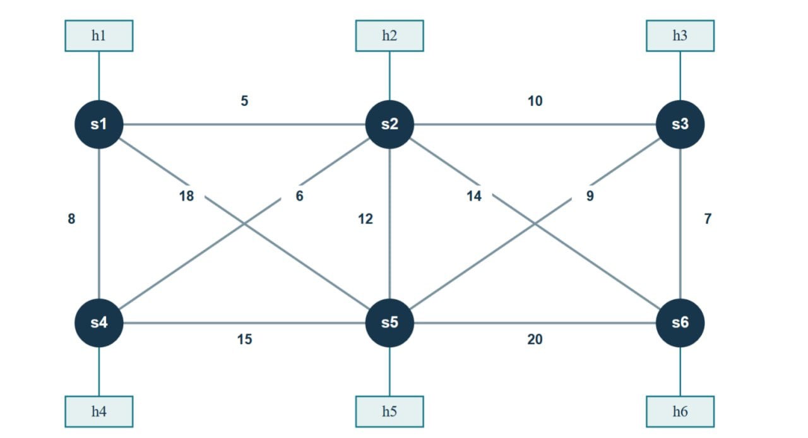
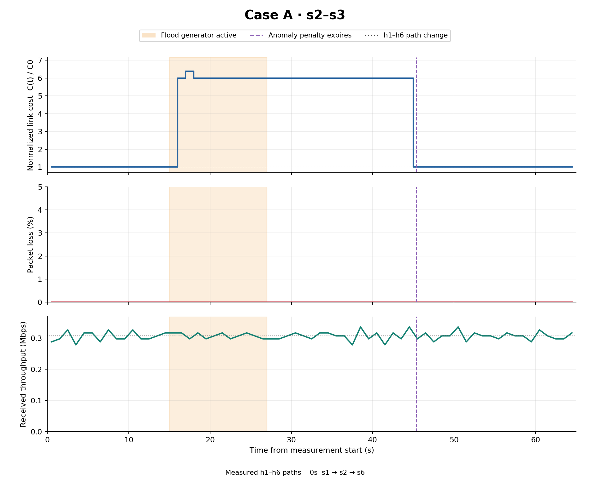
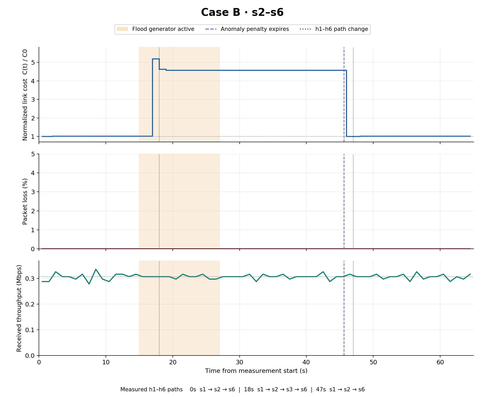
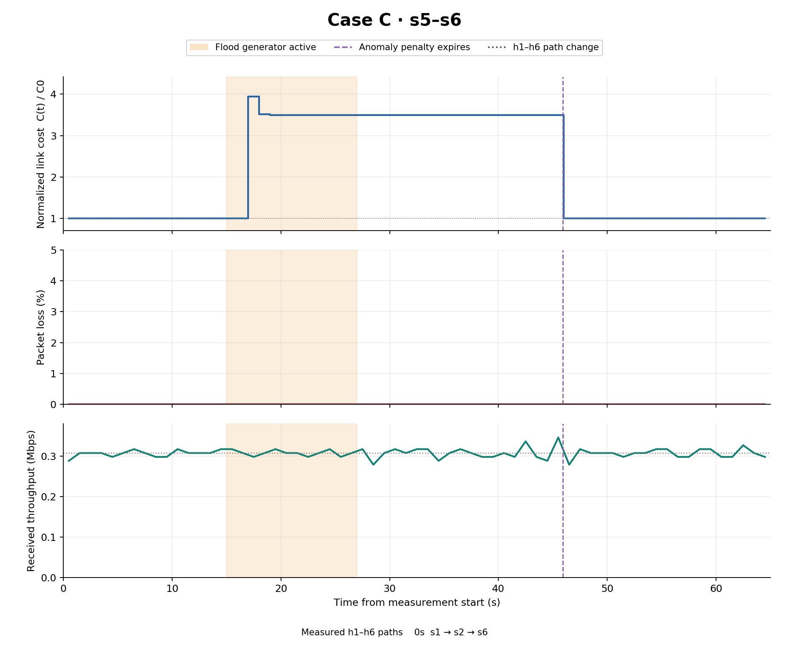

# CA2: Laboratory Assignment (Anomaly aware Routing and Blocking Controller)

This lab uses Ryu and OpenFlow 1.3 to route traffic through a six-switch mesh, prevent broadcast loops, detect unusually high source traffic rates, and block anomalous IPv4 sources. Legitimate hosts retain access to the mesh links after a source is blocked.

## Topology in MiniEdit
Open a new terminal inside the VM, run
```bash
sudo -E python ~/mininet/examples/miniedit.py
```
Open `/MininetLab/reference/ceg_mesh_topo.mn` in the MiniEdit.

The schematic of the topology is shown below, the base cost (default delay) for each mesh link is marked above the link.


## Traffic Monitoring, Anomaly Detection and Source Blocking
### Detect anomaly using EMA 
For each active flow, the sampled rate is the increase in its packet counter divided by the increase in its switch-reported flow duration. Rates are aggregated by source. Accepted samples update per-flow and per-source EMAs.

```text
EMA_new = alpha × current_rate + (1 - alpha) × EMA_previous
threshold = max(MIN_THRESHOLD_PPS, ANOMALY_MULTIPLIER × source_EMA_previous)
anomalous when current_source_rate > threshold
```

The comparison uses the previous baseline. An anomalous sample is excluded from EMA updates. Idle samples leave baselines unchanged. 


| Constant | Default | Meaning |
| --- | --- | --- |
| `POLL_SECONDS` | `1.0` | Flow-statistics polling interval |
| `EMA_ALPHA` | `0.2` | Weight assigned to the newest accepted sample |
| `ANOMALY_MULTIPLIER` | `5.0` | Source EMA multiplier |
| `MIN_THRESHOLD_PPS` | `50.0` | Minimum anomaly threshold in packets/s |


### Testing
In terminal 1, start the controller.

```bash
cd ~/MininetLab
bash run_controller.sh
```

`run_controller.sh` runs `ryu-manager` with `--observe-links` and listens on TCP port `6653`. Startup logs should report six switches, 11 mesh links, six host ports, and the broadcast tree.

In terminal 2, run the topology using Mininet.

```bash
cd ~/MininetLab
bash run_topology.sh
```

`run_topology.sh` starts Mininet with the topology and connects to the remote controller at `127.0.0.1:6653`. At the `mininet>` prompt, inspect the network and check connectivity.

```text
nodes
net
pingall
```

A fresh run should report `0% dropped (30/30 received)`. 

Now, establish the source baseline.

```text
h1 ping -c 10 h2
```

Watch terminal 1 for `BASELINE source=10.0.0.1` messages. Then run the following command in terminal 2 to simulate attack.

```text
h1 hping3 --icmp --flood h2
```

Stop the flooding after about 10 seconds. Check terminal 1, the controller should log an `ANOMALY` for `10.0.0.1` followed by six `FIREWALL` messages. Then inspect the actual switch rules by running following command in terminal 2.

```text
sh ovs-ofctl -O OpenFlow13 dump-flows s1 table=0
```

The flow table should contain a priority-100 rule matching `nw_src=10.0.0.1` with `actions=drop`. 

After the flood ends, check that the block persists and that the other hosts remain connected.

```text
h1 ping -c 3 h2
h4 ping -c 3 h2
```
h2 should receive no replies from h1 but can receive replies from h4.


## Dynamic Link-Cost Update

For each switch-to-switch link, the controller implements the supplied cost model.

```text
C_ij(t) = C0_ij + LOAD_COST_ALPHA × U_ij(t) + ANOMALY_COST_BETA × A_ij(t)
U_ij(t) = min(1, max(TX_rate_i_to_j, TX_rate_j_to_i) / capacity_ij)
TX_rate = 8 × change_in_tx_bytes / change_in_port_duration
```

### Original costs and units

| Link | Original cost |
| --- | --- |
| s1–s2 | 5 |
| s2–s3 | 10 |
| s4–s5 | 15 |
| s5–s6 | 20 |
| s1–s4 | 8 |
| s2–s5 | 12 |
| s3–s6 | 7 |
| s1–s5 | 18 |
| s2–s4 | 6 |
| s2–s6 | 14 |
| s3–s5 | 9 |

Bandwidth is read from each link's `bw` value and converted from Mbit/s to bit/s. Every supplied mesh link has a reference capacity of 40,000,000 bit/s. Host attachment links are excluded from the routing graph.

### Routing parameters and example

| Constant | Default | Meaning |
| --- | --- | --- |
| `LOAD_COST_ALPHA` | `30.0` | Cost added at full link utilization |
| `ANOMALY_COST_BETA` | `50.0` | Additional cost while an edge is anomaly-affected |
| `ANOMALY_HOLD_SECONDS` | `30.0` | Temporary edge-penalty lifetime |
| `ROUTE_IDLE_SECONDS` | `10.0` | Observed inactivity before route cleanup |
| `REROUTE_MIN_IMPROVEMENT` | `2.0` | Minimum absolute cost improvement |
| `REROUTE_MIN_FRACTION` | `0.10` | Minimum relative cost improvement |
| `REROUTE_COOLDOWN_SECONDS` | `5.0` | Minimum interval between active migrations |
| `BARRIER_TIMEOUT_SECONDS` | `2.0` | Acknowledgement timeout per switch |
| `OLD_PATH_DRAIN_SECONDS` | `1.0` | Retention of old-only path entries after migration |

The routing coefficient `LOAD_COST_ALPHA` is separate from the detector's `EMA_ALPHA=0.2`. Restart the controller after changing these constants.

For s1–s2, the original cost is 5. At 20 Mbit/s, utilization is 0.5 and the cost becomes `5 + 30 × 0.5 = 20`. The alternative s1–s4–s2 costs `8 + 6 = 14` when idle, so a new flow can prefer that alternative. If s1–s2 is also anomaly-affected, its cost becomes `20 + 50 = 70`. When traffic and the temporary penalty clear, its cost returns toward 5.

## Rerouting of Legitmate Traffic


### Method

Three independent 65-second trials used fresh controllers and the original topology. Each began with 30/30 successful ping checks. The continuous h1-to-h6 UDP stream offered 0.3072 Mbps using 32 datagrams/s of 1200 bytes each. A concurrent one-second ping checked bidirectional reachability. This legitimate rate stays below the 50 packets/s detector floor during baseline initialization.

The flood generator ran from 15 to 27 seconds. Measurement continued until 65 seconds to observe the 30-second anomaly penalty expire and the active route recover. The After phase includes the remaining penalty interval. Recovered starts two seconds after the measured penalty expiry.

Only each attack pair was pinned to the assigned direct link. Case C requires this constraint because s5–s3–s6 costs 16, below the direct s5–s6 cost of 20. h1–h6 remained fully adaptive in every case. Original link delays and bandwidths were preserved.

### Active-route design

The cost is C0 + 30 × utilization + 50 × anomaly. Utilization uses the busier TX direction divided by 40 Mbit/s, capped at 1. The anomaly term lasts 30 seconds after detection. The source firewall block persists for the controller session.

Routes are reconsidered once per second. Migration requires improvement of at least both 2 cost units and 10%, with a five-second cooldown. Installation proceeds destination-to-source, waiting for each switch's OpenFlow barrier acknowledgement. Rules match ingress port and IP pair. Old-only entries drain for one second before cookie-specific removal. Failed acknowledgements trigger restoration of the previous path. The ARP tree stays stable.

### Measurements

- Normalized cost is affected-link cost divided by original delay. Its base value is 1, and it can exceed 1.
- Loss uses transmitted UDP sequence numbers grouped by one-second send windows. Later arrivals within the capture are credited to their original send window.
- Throughput uses unique UDP payload bytes received by h6 in one-second receive windows. Offered rate is 0.3072 Mbps.
- Path changes are sampled approximately once per second. Actual flow-table snapshots independently verify paths at 10, 20, and 60 seconds.

### Case A

Attack on **s2-s3**, from **10.0.0.2** to **10.0.0.3**.

Original delay cost is **10.0**. The first measured affected-link cost is **10.000**. The initial h1–h6 path is **s1 → s2 → s6**, whose original delay sum is **19**.

| Phase | Mean link cost | Mean normalized cost | Loss (%) | Received throughput (Mbps) |
| --- | ---: | ---: | ---: | ---: |
| Before | 10.000 | 1.000 | 0.000 | 0.3053 |
| During | 56.160 | 5.616 | 0.000 | 0.3080 |
| After | 33.684 | 3.368 | 0.000 | 0.3069 |
| Recovered | 10.000 | 1.000 | 0.000 | 0.3068 |

Blocking was observed **2.01 seconds** after flood start. The sampled peak link cost was **63.921**, or **6.392 times its original value**. Penalty expiry was approximately **45.35 seconds**.

Recorded h1–h6 paths

- 0.0s — s1 → s2 → s6

The affected link was outside h1–h6's s1–s2–s6 route. That route stayed preferable, so the controller correctly retained it.

All six switches installed the source block. A three-second destination capture observed zero post-block attack packets while the flood remained active. The ingress drop counter increased from **245538 to 514164**. All 20 legitimate post-attack ping checks passed, and ordinary pings from the blocked source failed after the flood stopped.



### Case B

Attack on **s2-s6**, from **10.0.0.2** to **10.0.0.6**.

Original delay cost is **14.0**. The first measured affected-link cost is **14.001**. The initial h1–h6 path is **s1 → s2 → s6**, whose original delay sum is **19**.

| Phase | Mean link cost | Mean normalized cost | Loss (%) | Received throughput (Mbps) |
| --- | ---: | ---: | ---: | ---: |
| Before | 14.213 | 1.015 | 0.000 | 0.3059 |
| During | 56.499 | 4.036 | 0.000 | 0.3064 |
| After | 39.107 | 2.793 | 0.000 | 0.3072 |
| Recovered | 14.238 | 1.017 | 0.000 | 0.3076 |

Blocking was observed **2.01 seconds** after flood start. The sampled peak link cost was **72.674**, or **5.191 times its original value**. Penalty expiry was approximately **45.62 seconds**.

Recorded h1–h6 paths

- 0.0s — s1 → s2 → s6
- 18.0s — s1 → s2 → s3 → s6
- 47.0s — s1 → s2 → s6

The affected s2–s6 link was on the initial route. The active flow moved through s2–s3–s6 as the penalty made that alternative cheaper, then returned to the direct s2–s6 segment after recovery.

All six switches installed the source block. A three-second destination capture observed zero post-block attack packets while the flood remained active. The ingress drop counter increased from **200760 to 460013**. All 20 legitimate post-attack ping checks passed, and ordinary pings from the blocked source failed after the flood stopped.



### Case C

Attack on **s5-s6**, from **10.0.0.5** to **10.0.0.6**.

Original delay cost is **20.0**. The first measured affected-link cost is **20.001**. The initial h1–h6 path is **s1 → s2 → s6**, whose original delay sum is **19**.

| Phase | Mean link cost | Mean normalized cost | Loss (%) | Received throughput (Mbps) |
| --- | ---: | ---: | ---: | ---: |
| Before | 20.000 | 1.000 | 0.000 | 0.3059 |
| During | 62.434 | 3.122 | 0.000 | 0.3072 |
| After | 45.000 | 2.250 | 0.000 | 0.3069 |
| Recovered | 20.000 | 1.000 | 0.000 | 0.3074 |

Blocking was observed **2.01 seconds** after flood start. The sampled peak link cost was **78.924**, or **3.946 times its original value**. Penalty expiry was approximately **45.92 seconds**.

Recorded h1–h6 paths

- 0.0s — s1 → s2 → s6

The affected link was outside h1–h6's s1–s2–s6 route. That route stayed preferable, so the controller correctly retained it.

All six switches installed the source block. A three-second destination capture observed zero post-block attack packets while the flood remained active. The ingress drop counter increased from **218983 to 487189**. All 20 legitimate post-attack ping checks passed, and ordinary pings from the blocked source failed after the flood stopped.



### Interpretation and limits

The firewall stops sustained attack forwarding shortly after detection. High link load is consequently a short burst even while the generator continues until 27 seconds. Costs remain elevated during the anomaly hold, then return toward the original values. A link carrying the continuing legitimate stream retains a small load surcharge.

Loss and throughput are measured at the receiver. Per-second throughput fluctuations can reflect packet timing and VM scheduling. Shared destination links and CPU load can affect delivery even when the targeted switch link is outside h1–h6's path. These trials establish continuity at the stated offered load. Maximum TCP capacity was not measured. One trial per case provides no statistical confidence interval.

### Reproduce

With the previous network and controller stopped, run inside the VM.

```bash
cd ~/MininetLab
python3 -m unittest -v test_dynamic_cost.py
sudo env PYTHONDONTWRITEBYTECODE=1 python3 -u evaluate_task4.py
sudo python3 plot_task4.py
```

Raw datagram logs, telemetry, captures, summaries, and flow snapshots are in results/task4/case_a, case_b, and case_c. The CSV files contain one-second measurements. Each run replaces these case outputs.


## Reset and troubleshooting

For a fresh experiment, enter `exit` in the interactive Mininet session or let the automated test finish. Stop Ryu with Ctrl+C, then start the controller and topology again. This resets learned baselines and the blocked-source set, and switch initialization replaces the prior flow rules.

| Symptom | Check |
| --- | --- |
| Topology file cannot be read | Verify that `reference/ceg_mesh_topo.py` exists inside this repository |
| Switches cannot connect | Start Ryu first, check port 6653, and retain the launcher's remote-controller and OpenFlow 1.3 settings |
| Port 6653 is already occupied | Run `sudo ss -ltnp 'sport = :6653'` and stop the identified previous lab controller |
| Fresh test immediately fails connectivity involving h1 | Restart Ryu to clear the previous experiment's source block |
| Test cannot find a required executable | Recheck the prerequisites and tool paths inside the VM |
| Interfaces remain after an interrupted Mininet run | Close active lab sessions, then run `sudo mn -c` before restarting. This cleanup affects Mininet resources across the VM |
| Capture exits with status 124 in test results | This is the expected timeout when no matching attack packet arrives during the capture window |

Inspect controller connectivity from the Mininet prompt.

```text
sh ovs-vsctl --columns=target,is_connected list Controller
```
