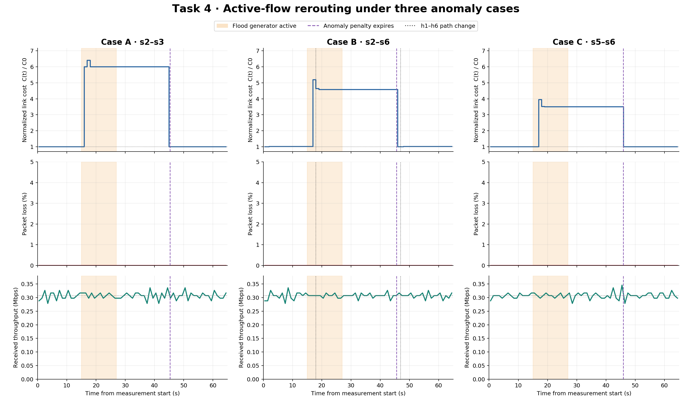
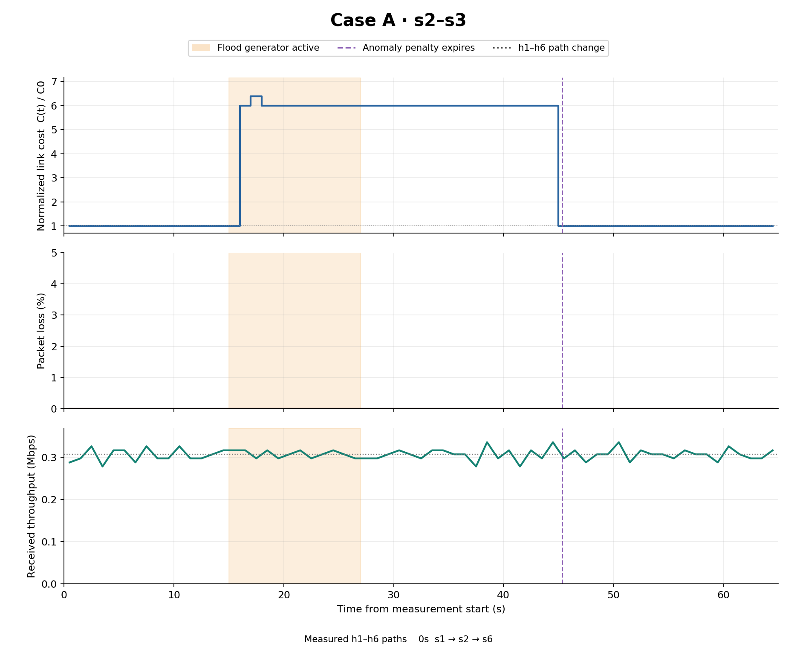
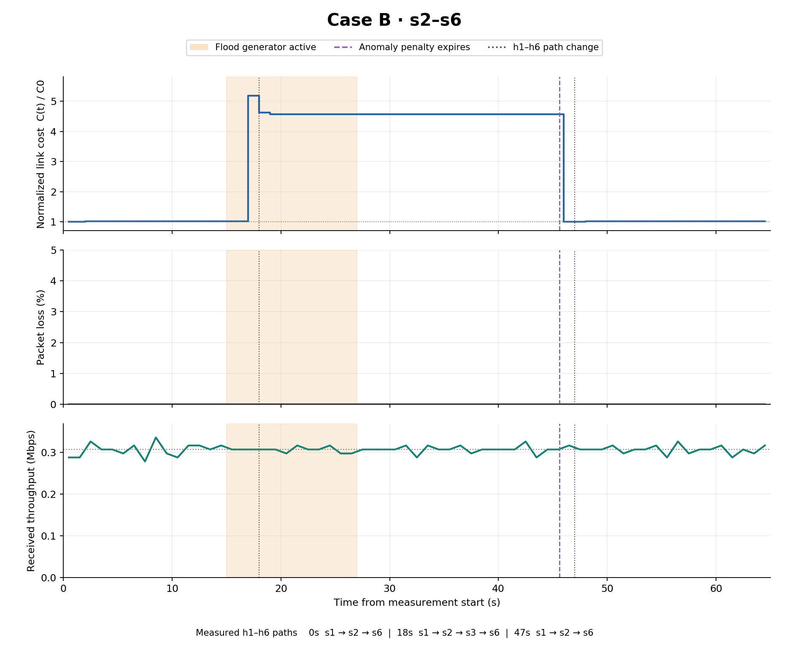
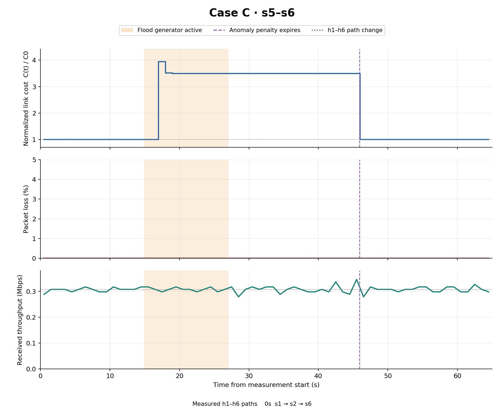

# Task 4 evaluation

Measured on 10 November 2026 in Multipass VM ca2-part1.

## Method

Three independent 65-second trials used fresh controllers and the original topology. Each began with 30/30 successful ping checks. The continuous h1-to-h6 UDP stream offered 0.3072 Mbps using 32 datagrams/s of 1200 bytes each. A concurrent one-second ping checked bidirectional reachability. This legitimate rate stays below the 50 packets/s detector floor during baseline initialization.

The flood generator ran from 15 to 27 seconds. Measurement continued until 65 seconds to observe the 30-second anomaly penalty expire and the active route recover. The After phase includes the remaining penalty interval. Recovered starts two seconds after the measured penalty expiry.

Only each attack pair was pinned to the assigned direct link. Case C requires this constraint because s5–s3–s6 costs 16, below the direct s5–s6 cost of 20. h1–h6 remained fully adaptive in every case. Original link delays and bandwidths were preserved.

## Active-route design

The cost is C0 + 30 × utilization + 50 × anomaly. Utilization uses the busier TX direction divided by 40 Mbit/s, capped at 1. The anomaly term lasts 30 seconds after detection. The source firewall block persists for the controller session.

Routes are reconsidered once per second. Migration requires improvement of at least both 2 cost units and 10%, with a five-second cooldown. Installation proceeds destination-to-source, waiting for each switch's OpenFlow barrier acknowledgement. Rules match ingress port and IP pair. Old-only entries drain for one second before cookie-specific removal. Failed acknowledgements trigger restoration of the previous path. The ARP tree stays stable.

## Measurements

- Normalized cost is affected-link cost divided by original delay. Its base value is 1, and it can exceed 1.
- Loss uses transmitted UDP sequence numbers grouped by one-second send windows. Later arrivals within the capture are credited to their original send window.
- Throughput uses unique UDP payload bytes received by h6 in one-second receive windows. Offered rate is 0.3072 Mbps.
- Path changes are sampled approximately once per second. Actual flow-table snapshots independently verify paths at 10, 20, and 60 seconds.



## Case A

Attack on **s2-s3**, from **10.0.0.2** to **10.0.0.3**.

Original delay cost is **10.0**. The first measured affected-link cost is **10.000**. The initial h1–h6 path is **s1 → s2 → s6**, whose original delay sum is **19**.

| Phase | Mean link cost | Mean normalized cost | Loss (%) | Received throughput (Mbps) |
| --- | ---: | ---: | ---: | ---: |
| Before | 10.000 | 1.000 | 0.000 | 0.3053 |
| During | 56.160 | 5.616 | 0.000 | 0.3080 |
| After | 33.684 | 3.368 | 0.000 | 0.3069 |
| Recovered | 10.000 | 1.000 | 0.000 | 0.3068 |

Blocking was observed **2.01 seconds** after flood start. The sampled peak link cost was **63.921**, or **6.392 times its original value**. Penalty expiry was approximately **45.35 seconds**.

Recorded h1–h6 paths

- 0.0s — s1 → s2 → s6

The affected link was outside h1–h6's s1–s2–s6 route. That route stayed preferable, so the controller correctly retained it.

All six switches installed the source block. A three-second destination capture observed zero post-block attack packets while the flood remained active. The ingress drop counter increased from **245538 to 514164**. All 20 legitimate post-attack ping checks passed, and ordinary pings from the blocked source failed after the flood stopped.



## Case B

Attack on **s2-s6**, from **10.0.0.2** to **10.0.0.6**.

Original delay cost is **14.0**. The first measured affected-link cost is **14.001**. The initial h1–h6 path is **s1 → s2 → s6**, whose original delay sum is **19**.

| Phase | Mean link cost | Mean normalized cost | Loss (%) | Received throughput (Mbps) |
| --- | ---: | ---: | ---: | ---: |
| Before | 14.213 | 1.015 | 0.000 | 0.3059 |
| During | 56.499 | 4.036 | 0.000 | 0.3064 |
| After | 39.107 | 2.793 | 0.000 | 0.3072 |
| Recovered | 14.238 | 1.017 | 0.000 | 0.3076 |

Blocking was observed **2.01 seconds** after flood start. The sampled peak link cost was **72.674**, or **5.191 times its original value**. Penalty expiry was approximately **45.62 seconds**.

Recorded h1–h6 paths

- 0.0s — s1 → s2 → s6
- 18.0s — s1 → s2 → s3 → s6
- 47.0s — s1 → s2 → s6

The affected s2–s6 link was on the initial route. The active flow moved through s2–s3–s6 as the penalty made that alternative cheaper, then returned to the direct s2–s6 segment after recovery.

All six switches installed the source block. A three-second destination capture observed zero post-block attack packets while the flood remained active. The ingress drop counter increased from **200760 to 460013**. All 20 legitimate post-attack ping checks passed, and ordinary pings from the blocked source failed after the flood stopped.



## Case C

Attack on **s5-s6**, from **10.0.0.5** to **10.0.0.6**.

Original delay cost is **20.0**. The first measured affected-link cost is **20.001**. The initial h1–h6 path is **s1 → s2 → s6**, whose original delay sum is **19**.

| Phase | Mean link cost | Mean normalized cost | Loss (%) | Received throughput (Mbps) |
| --- | ---: | ---: | ---: | ---: |
| Before | 20.000 | 1.000 | 0.000 | 0.3059 |
| During | 62.434 | 3.122 | 0.000 | 0.3072 |
| After | 45.000 | 2.250 | 0.000 | 0.3069 |
| Recovered | 20.000 | 1.000 | 0.000 | 0.3074 |

Blocking was observed **2.01 seconds** after flood start. The sampled peak link cost was **78.924**, or **3.946 times its original value**. Penalty expiry was approximately **45.92 seconds**.

Recorded h1–h6 paths

- 0.0s — s1 → s2 → s6

The affected link was outside h1–h6's s1–s2–s6 route. That route stayed preferable, so the controller correctly retained it.

All six switches installed the source block. A three-second destination capture observed zero post-block attack packets while the flood remained active. The ingress drop counter increased from **218983 to 487189**. All 20 legitimate post-attack ping checks passed, and ordinary pings from the blocked source failed after the flood stopped.



## Interpretation and limits

The firewall stops sustained attack forwarding shortly after detection. High link load is consequently a short burst even while the generator continues until 27 seconds. Costs remain elevated during the anomaly hold, then return toward the original values. A link carrying the continuing legitimate stream retains a small load surcharge.

Loss and throughput are measured at the receiver. Per-second throughput fluctuations can reflect packet timing and VM scheduling. Shared destination links and CPU load can affect delivery even when the targeted switch link is outside h1–h6's path. These trials establish continuity at the stated offered load. Maximum TCP capacity was not measured. One trial per case provides no statistical confidence interval.

## Reproduce

With the previous network and controller stopped, run inside the VM.

```bash
cd ~/MininetLab
python3 -m unittest -v test_dynamic_cost.py
sudo env PYTHONDONTWRITEBYTECODE=1 python3 -u evaluate_task4.py
sudo python3 plot_task4.py
```

Raw datagram logs, telemetry, captures, summaries, and flow snapshots are in results/task4/case_a, case_b, and case_c. The CSV files contain one-second measurements. Each run replaces these case outputs.
